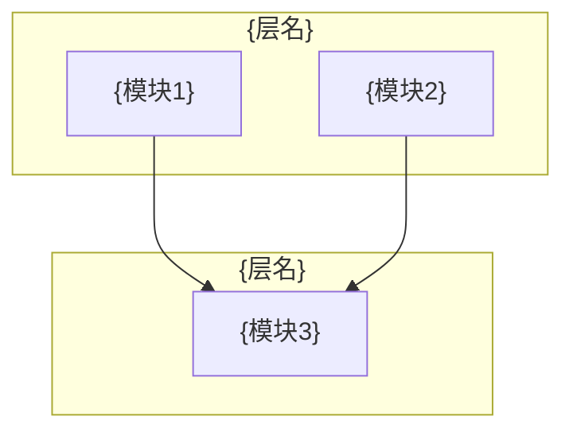

# {项目名} 目标架构 (L1)

> **定位**: 全局宏观骨架 + 根路由表
> **更新日期**: YYYY-MM-DD

---

## 一、端到端架构图

---

## 二、核心模块职责

| 层级 | 模块名称 | 依赖项 | 核心职责 |
|:---:|------|------|------|
| L0 | {模块名} | 无 | {职责描述} |
| L1 | {模块名} | {依赖} | {职责描述} |

---

## 三、根路由表

| 如果你的任务涉及... | 进入领域 | 首先加载 |
|---|---|---|
| {概念/模块类型} | **Domain {N}: {领域名}** | `L0_{domain}_rules.md` + `L1_{domain}_router.md` |

---

## 四、跨领域接口清单

| 接口 | 提供方 | 消费方 | 协议/格式 |
|------|-------|-------|---------|
| {接口名} | Domain {N} | Domain {M} | {协议} |

---

## 五、核心设计原则

| 原则 | 说明 |
|------|------|
| {原则1} | {简短说明} |
| {原则2} | {简短说明} |
