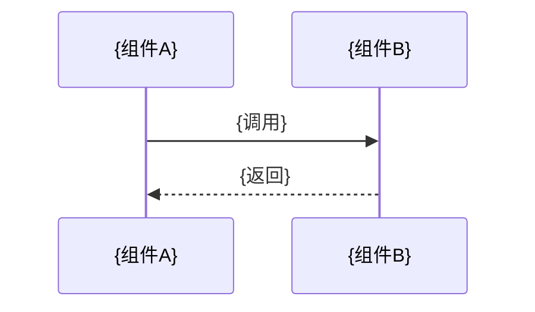

---
domain: "{领域编号}_{领域名}"
module: "{模块名}"
match_globs:
  - "src/path/to/*.hpp"
  - "src/path/to/*.cxx"
status: "已实现"       # 已实现 / 部分实现 / 待实现 / 已废弃
last_updated: "YYYY-MM-DD"
# depends_on: []  # 可选：实际依赖的项目内 L2 文档相对路径；无消费者时省略
---

# {模块名称}

> **关键字**: {核心概念1}, {核心概念2}

---

## 1. {设计/实现细节段落1}

{具体内容, 可包含代码块、Mermaid 图、表格}

## 2. {设计/实现细节段落2}

{具体内容}

## 适用条件与证据（仅对易漂移的关键结论保留）

| 结论或现有章节锚点 | 适用版本/配置/环境 | 依据或原始证据 | 何种变化需要复核 | 替代入口（有则填写） |
|------------------|------------------|----------------|------------------|--------------------|
| {关键结论} | {与结论有关的条件} | {源码、测试或观察位置} | {依赖变化、反证等} | {已被替代时指向当前结论} |

> 日期与改动命中只提示复核，不自动证明结论失效。历史验收与当前可复用性分开；需要机器传播时才在 front matter 的 `depends_on` 列出真实存在的项目内 L2 路径。源文件/配置仍使用 `match_globs`，不增加第二套知识库。

## 3. 数据流

## 4. 已知陷阱

> 当用户、适用合同或真实知识消费者需要沉淀，并且该陷阱已由实现或证据证实时，由 `dlm-sediment` 精确更新；任务完成本身不自动触发追加。

| 陷阱 | 现象 | 根因 | 解决方案 | 发现日期 |
|------|------|------|----------|---------|
| {ID} | {现象} | {根因} | {正确做法} | YYYY-MM-DD |

## 5. 演进记录

> 当真实知识消费者需要记录 L2-Behavioral 变更时，由 `dlm-sediment` 精确更新或追加。若上方正文已与事实矛盾，应修正旧真相，不能仅叠加第二份说法。

### YYYY-MM-DD — {变更标题}
- **变更**: {什么逻辑改了}
- **原因**: {为什么改}
- **影响**: {对调用方/下游的影响}
